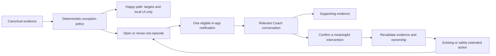

# AI Coach: exception-only coaching implementation plan

Status: product direction approved 2026-10-13. Slice A's pure classifier and Slice B's shared
effective targets are implemented; persistence, conversations and the entry switch remain planned.
Delivery owner: [#206](https://github.com/jms-dcksn/lifting-app/issues/206), under [#136](https://github.com/jms-dcksn/lifting-app/issues/136).

## Outcome

Keep the deterministic recommendation engine. AI Coach becomes the coaching entry point,
without making users visit Track Coach to click Accept or Accept all.

Ordinary progression stays quiet. When something needs attention, an in-app notification
opens a relevant Coach conversation with the reason, evidence and **See details**.
Meaningful choices, such as a rep-range change or exercise swap, happen in that conversation.
An explanation always distinguishes a recommended change from a current target or applied change.

## Approved behavior

| Engine outcome | Delivery | Action |
| --- | --- | --- |
| PR, gaining trend, earned load increase, added rep | Silent | Existing records/recap and automatically calculated workout targets |
| One down session; keep movement | Silent | Keep the engine's conservative target and optional local explanation |
| One below-rep-floor recalibration | Silent | Calculate the target; explain beside it |
| Two consecutive comparable first-set effort misses | Notify once per situation | Automatically use the supported reduced target for upcoming suggestions; explain it |
| Repeated below-floor reductions | Notify once per situation | Require two eligible exposures each independently supporting a reduction; explain the repeated recalibration |
| Confirmed plateau | Notify once per situation | Review evidence; Fluid proposes a rep-range change first, then an exercise swap at its next intervention rung |
| Current sustained decline | Notify once per situation | Explain the supported trend; merge with a related plateau/reduction message |
| Scheduled deload/recovery at 4+ RIR | Silent | Existing phase label and canonical recovery targets |
| Significant joint pain | Prompt in-app notification | Review required; no invented affected lift or pain-specific numerical target |
| Flat trend, insufficient history, expected calibration | Silent | Contextual exercise-card explanation or input request |
| Hard-set shortfall, readiness, mild pain, adherence/duration signals | No standalone notification | Available as factual conversation context; no new intervention rule in V1 |

Existing default plateau detection requires three stalled exposures (four for barbells),
or the configured patience, spanning at least 14 days. Fixed-load rep gains reset the stall.
Decline classification requires four eligible exposures; both recent values must be below
both prior values by more than 1%. Validate that the evidence still applies to the current
exercise/equipment/prescription context before delivering it.

The two-exposure repeated below-floor notification rule is a product default, not a new
strength formula. Repeated reads of one exposure do not satisfy it.

## What source currently does

Original implementation baseline checked against main `2b919d7fca044b220a48fc8358dcaa1f4c61a79c`.

- `src/lib/strength/progression.ts`: `sessionTarget()` already calculates ordinary progression,
  below-floor recalibration and recovery loads automatically.
- `src/lib/coach-recommendations.ts`: produces eight recommendation kinds. `reduce_load`
  has two causes, so notification selection cannot rely on kind alone. The priority ranking
  deliberately elevates some successful load increases and is unsuitable for notifications.
- `src/lib/coach-ui-data.ts`: `loadCoachUi` combines factual report, proposals and legacy decisions.
- `src/lib/coach-recommendation-decisions.ts` and analytics actions: Accept/dismiss/defer
  record review state; they do not apply training changes.
- `src/lib/stall-report.ts` and `src/lib/fluid.ts`: shared stall evidence and Fluid intervention
  ladder. The Fluid UI currently asks for acceptance before writing an adaptation.
- `src/lib/effective-workout-target.ts` now composes canonical targets and repeated-effort
  reductions for Home/planner, active-session initial suggestions and next/weekly Coach tools.
- Significant pain in finished sessions in the report window produces a session-level
  `pain_review` and suppresses other Coach proposals. It does not calculate reduced loads
  or automatically suppress the separate session target engine.
- `src/lib/coach-check-in.ts`: reporting uses Monday–Sunday calendar weeks, documented in
  the Coach report contract. Program weeks used for targets are a separate concept.

## Implementation boundaries

Keep four distinct responsibilities:

1. **Training engines:** calculations, canonical history/stalls and supported adaptations.
2. **Exception policy:** determines whether evidence represents a notify-worthy situation.
3. **Episode/inbox lifecycle:** persistence, revalidation, suppression and delivery identity.
4. **AI Coach:** grounded explanation, details navigation and meaningful confirmed actions.

Domain boundaries (only classification is implemented):

```ts
classifyCoachExceptions(input: CoachExceptionInput): CoachExceptionCandidate[]
resolveEffectiveWorkoutTarget(context): EffectiveTarget | null
reconcileCoachEpisodes(userClient, candidates, asOf): ReconciliationResult
openCoachEpisode(userClient, episodeId): ConversationDestination
```

Candidates carry a typed reason, owner-validated source references, exact identity/context,
evidence dates, target availability and `recommended`, `current_target`, or `applied` status.
Keep internal source IDs out of public report exports while retaining them inside the
authorized exception envelope. Never infer causes from generated text.

The language model does not select alert eligibility, calculate loads, choose a notification
severity, or apply a change merely by producing text. Keep `sessionTarget()` pure and share
the existing effort-mismatch rule through one canonical composition layer.

## Episode lifecycle and delivery

An episode is one continuing situation, not one proposal hash or exposure. Its identity
includes the owner, reason family and exact slot/exercise/equipment/prescription context;
session-level pain keeps its actual session scope. New evidence revises an episode without
creating another unread alert automatically.

Proposed lifecycle:



- Prioritize significant pain, then repeated effort mismatch, plateau and decline. Group
  overlapping non-pain causes for the same affected lift into one explanation. Pain takes
  precedence; do not send conflicting progression advice while its review is outstanding.
- Notify on a new situation, material escalation or changed intervention, not every exposure.
  No automatic reminder cadence in V1. Read/dismiss/acknowledge affects delivery only.
- Preserve Fluid's two-exposure snooze. Snooze and resolution must not be inferred from
  legacy accepted review rows. An applied intervention supersedes its stale proposal.
- Resolve/supersede performance episodes only from supported fresh evidence, changed context,
  applied intervention or corrected/deleted source evidence. Missing history is not recovery.
- Pain acknowledgement is not evidence that pain resolved. A report-window rollover alone
  must not resolve its persisted episode. The exact recurrence/resolution contract belongs
  in #212 and must not introduce medical inference or a new numerical pain rule.
- Do not let old report history create fresh decline alerts after a long gap. Revalidate
  against the affected slot's current eligible evidence; absent comparability means no alert.
- Bootstrap quietly: do not replay all historical proposals. Existing significant pain or
  current actionable exceptions can be surfaced on initial refresh under an explicit cutoff
  chosen in #212, with a test proving no historical alert flood.

V1 delivery is authenticated and in-app. Reconcile after finishing a workout or changing
completed-session feedback; edits/deletions, accepted adaptations and program changes
invalidate/reconcile affected evidence. Also refresh on signed-in app entry and upcoming-workout
review, so a failed refresh can recover without visiting Coach. Never add model calls to
set logging. Do not roll back a saved workout if notification processing fails: expose retryable
refresh status and recover on the next authenticated refresh.

Notifications/preferences are persistent and owner-scoped. Outside active-session chrome,
use an inbox/badge and compact arrival indication; do not interrupt set entry. Quiet hours
defer arrival prompts; the inbox and local evidence remain accessible. Delivery categories
can be disabled without changing target calculations or erasing an existing pain review.
The concrete preference defaults and suppression behavior must be explicit in #212.

Initial notification copy is deterministic. Opening the item creates/reuses one episode-linked
conversation, seeded with bounded authorized evidence and a grounded explanation. A model
turn follows the existing user-invoked chat path; no scheduled generation or new paid provider.
Repeated opens reuse the thread rather than duplicating messages. Deleted/stale destinations
open an honest explanation without retaining actionable stale buttons.

Native push remains #196 after #43. No browser push, email, worker or cron in V1. A web app
without such a transport does not deliver notifications while closed; the inbox is waiting
when the user returns. No revival of the retired weekly capability-token API.

## Target application and meaningful choices

Automatic behavior: ordinary load/rep progression, canonical recovery/below-floor targets,
and the existing supported two-exposure effort reduction composed into upcoming suggestions.
Repeated evaluation is idempotent: it derives from logged evidence, not the prior suggested
target, and never repeatedly subtracts increments. Preserve user choices, phase prescriptions,
exact identity and bodyweight conventions. Do not overwrite entered/logged sets or materially
change an already-open workout without an explicit interaction.

Significant pain means **review required**, not a promise of a pain-safe numerical target.
Any future automatic pain-related target change requires a separately specified engine rule.
The conversation states the actual limitation; no medical diagnosis or guessed affected lift.

Rep-range changes and exercise swaps remain meaningful confirmed choices. Reuse current
adaptation/swap semantics, preserving scope and history. Current `acceptAdaptation` requires
a session ID and is not a ready-made safe pre-workout action: #212 must design authorization,
idempotency and atomicity before #141 extends it. An episode ID is a lookup reference, not
authorization. Revalidate current owner, slot, evidence and candidate when the user confirms.

Offer **Change rep range**, **Choose replacement**, **Keep going**, and **See details** as
appropriate. Remove generic Accept/Accept all from the routine coaching workflow. Preserve
legacy decision data without interpreting acceptance as an applied intervention.

## Delivery slices

### Slice A — Deterministic exception policy

Issue: [#210](https://github.com/jms-dcksn/lifting-app/issues/210).
Implemented first step; no persistence, delivery integration or model calls.

Introduce typed reason/evidence envelopes and pure classification. Cover every row of the
policy table, both reduction causes and all Fluid actions. Verify current comparability,
staleness, overlapping signals and confidence/data sufficiency. Do not change the underlying
PR, progression or plateau formulas.

Contract: [deterministic eligibility](AI-COACH.md#deterministic-exception-eligibility-210).
The caller supplies an explicit evidence cutoff and current exact slot context; every
supporting exposure must be inside that window. The classifier returns recommended
signals with source references, groups overlaps per slot and preserves session-scoped pain.
It never resolves episodes or claims a recommendation is applied/current. Bootstrap cutoff
and lifecycle choices still belong to C/D; B supplies the effective workout target later.

### Slice B — Effective target consistency

Issue: [#211](https://github.com/jms-dcksn/lifting-app/issues/211).
Implemented, coordinated with A's effort reason; no inbox dependency.

Compose the existing effort-reduction rule with canonical targets once. Home/planner,
active-session initial targets, agent nextWorkout and Coach explanations consume the same
effective result. Validate upcoming phase/context rather than directly applying a proposal
derived from the last session's phase. Preserve the existing unknown-target state.

Contract: [effective targets](AI-COACH.md#effective-workout-targets-211). The result distinguishes
current calculated suggestions from recommended structural interventions. Complete owner
history is projected to exact first-set references; open sessions preserve entered/saved
values and use stored context with pre-start history. Reads never compound reductions.

### Slice C — Persistence and action design

Issue: [#212](https://github.com/jms-dcksn/lifting-app/issues/212).
Design delivered in [episode storage/replay/action proposal](AI-COACH-EPISODES-DESIGN.md).
The owner authorized proceeding with #195 on 2026-10-14. The design PR merge alone did
not authorize it. Inbox implementation is in [COACH-INBOX.md](COACH-INBOX.md); adaptation
actions and linked conversations in E remain #141.

Prepare a concrete Decision Card for schema, retention, constraints, replay semantics,
episode/thread ownership, bootstrap, preferences and pre-workout action authorization.
Prefer the smallest extension to existing Supabase/thread infrastructure; do not select a
new service. Include grants, RLS, transactions, indexes, compatibility and rollback.
This plan approves the product direction, not an unreviewed schema or privileged worker.

The proposal separates stable episodes, evidence revisions and notice delivery; defines
90-day supporting/21-day freshness defaults, persistent pain review and two-exposure snooze;
and specifies owner-scoped signed commands, source guards and atomic Fluid receipts.
The owner approved these inbox defaults and storage choices for #195 on 2026-10-14.
Their implementation and rollout are documented in [COACH-INBOX.md](COACH-INBOX.md).

### Slice D — Persistent exception inbox and refresh

Issue: [#195](https://github.com/jms-dcksn/lifting-app/issues/195).
Implemented in #195; depends on A and approved C and integrates target context from B.
See [inbox contract](COACH-INBOX.md) for shipped behavior and rollout.

Implement episodes, delivery/preferences and authenticated refresh hooks. Prove atomic
deduplication under retries/concurrent tabs, stale/corrected evidence handling, episode
suppression and eventual retry after a successful training write. Existing engine activity
and local warnings continue even when notifications are disabled. No scheduled recap/preview
delivery is included.

### Slice E — Conversation, details and confirmed interventions

Issue: [#141](https://github.com/jms-dcksn/lifting-app/issues/141).
Depends on D, target context from B, and C's action contract.

Open/reuse an episode-linked conversation. Provide source-grounded explanation, **See details**,
and valid scoped intervention buttons. Revalidate and atomically apply confirmed changes.
Retain separately requested settings writes under their existing confirmation boundary;
they are not a prerequisite for the exception journey. Bound chat/tool costs and never
treat a model-generated action or legacy accepted proposal as a confirmed mutation.

### Slice F — AI Coach entry point and retire routine acceptance

Issue: [#206](https://github.com/jms-dcksn/lifting-app/issues/206), also tracking A–E.
Depends on the working exception journey; switch the default entry last.

Replace Track's standalone acceptance entry with AI Coach. Update monthly stall links,
legacy `coachExercise` links and `openCoachCheckIn` to preserve relevant context. Retain
the tested report/evidence view as an optional read-only detail surface or equivalent Sheet;
it is not a required stop to apply targets. Remove routine Accept/Accept all controls once
the replacement flow works. Route compatibility must not send the user around a chat loop.

## Backlog reconciliation

| Issue | Updated responsibility |
| --- | --- |
| #136 | AI Coach umbrella; shipped 0–2 baseline, then exception journey A–F; read tools can proceed independently |
| #206 | Delivery owner and final entry-point/acceptance-workflow switch |
| #195 | V1 exception inbox/episodes/preferences, not a generic happy-path message scheduler |
| #141 | Meaningful confirmed interventions and conversation context; no routine review bookkeeping |
| #140 | Grounded on-demand weekly narrative; tool already exists, remaining work is quality/contract coverage |
| #199 | On-demand next-workout focus/resources; no proactive happy-path preview |
| #200 | Close as superseded by #140 for on-demand recaps and #195 for exception delivery |
| #196 | Native transport for the same eligible episodes; still waits for native #43 |
| #142 | Later sophistication umbrella; retains its own decisions and dogfood gate, not an exception-policy implementation |
| #208 | Program-week target retrieval, using shared effective targets; distinct from calendar reporting |
| #205 | Hypothetical read-only calculator; independent of notifications and logged records |
| #44 | Close as superseded by #136 |
| #107 | Close obsolete classification/start-Coach gate; no model-based exception classifier |
| #181 | Refresh stale eval baseline; keep trace replay and live development-ledger evaluation distinct |
| #177/#201/#202 | Keep custom inactive drafts/research separate; no automatic active-program swaps |

#27 remains open for its explicitly unverified product acceptance checks. Empty intake issues
#41/#42 and parked #43 remain unchanged. Preserve closed historical issue bodies; use closure
notes rather than deleting evidence of earlier decisions.

## Verification and rollout

- A/B: meaningful pure policy and cross-consumer target tests, frozen time where needed.
  Include every silent happy-path case, repeated effort versus isolated misses, stale/missing
  evidence, exact machines/instances, bodyweight assistance and phase/adaptation resets.
- C/D/E: two-user pgTAP for episode/preferences/thread access and ownership-changing updates;
  app tests for retry/concurrency, stale confirmation, bootstrap, deletion/edit invalidation,
  snooze, quiet hours and disabled categories. Use least-privilege grants and owner predicates,
  as described in [Supabase's RLS guide](https://supabase.com/docs/guides/database/postgres/row-level-security).
- UI: phone-width authenticated journey from finish/pain feedback to inbox, conversation,
  details and action; reload/multiple tabs, no active-workout interruption, quiet hours,
  stale links, accessibility and failure recovery. Pain plus a PR must show the PR normally
  while producing only the relevant exception notification.
- Agent evals: supported current-target/recommended/applied claims; no invented diagnosis,
  attribution, loads, dates or accepted changes. No paid live evaluation without its own
  authorization. Sanitized fixtures cover the baseline.
- Each application slice runs tests, lint, typecheck and build; DB slices also run
  `npm run test:db`. Update AI-COACH.md, COACH-REPORT.md, owning feature docs and ai-coach.html
  with accurate diagrams and landed snippets. No optional provider migration.
- Ship A/B first, then approved D/E, then F after user dogfood. Do not retire the existing
  review entry before the replacement works. Record observed delivery counts and suppression
  reasons without adding raw pain notes to notification payloads/logs.

The original planning change introduced no application behavior. Slices A/B add pure policy
and shared target suggestions without migrations, training writes, scheduled jobs or delivery changes.
